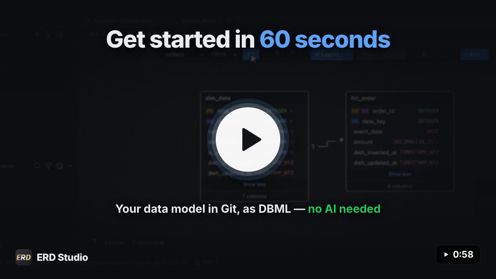

<h1 align="center">ERD Studio</h1>

<p align="center">
  <strong>Design your data model in Git. Let your AI build from it.</strong><br />
  Logical data modelling in VS Code, stored as DBML in your repo.
</p>

<p align="center">
  <a href="https://marketplace.visualstudio.com/items?itemName=liamwynne.erd-studio"></a>
</p>

<p align="center">
  <a href="https://marketplace.visualstudio.com/items?itemName=liamwynne.erd-studio"></a>
  <a href="https://marketplace.visualstudio.com/items?itemName=liamwynne.erd-studio"></a>
  <a href="https://open-vsx.org/extension/liamwynne/erd-studio"></a>
  <br />
  <sub>Free to use. Source available under the <a href="https://github.com/liam-machine/erd-studio/blob/main/LICENSE">PolyForm Shield licence</a>.</sub>
</p>

**A data model that lives apart from the code goes stale, and after three months nobody trusts it.** ERD Studio keeps yours in your repo: you draw it on a canvas in VS Code, each table is a DBML file, and a model change is reviewed in the same pull request as the SQL.

<p align="center">
  
</p>

<p align="center">
  <br />
  <sub>The real canvas: hover a table and its lines light up.</sub>
</p>

**dbt is an add-on.** Your model works in any folder; in a dbt project, **Compare with dbt** also marks where your design and your models differ ([Using ERD Studio with dbt](docs/dbt.md)).

> "Amazing, great to combine with Github Copilot."
>
> "An ERD tool made for AI and dbt, so much better then paid options out there."
>
> Reviews on the Visual Studio Marketplace

Built by a data engineer who wanted the model reviewed with the code: [liam-machine on GitHub](https://github.com/liam-machine).

## What it is

ERD Studio is a logical modelling canvas that saves your tables, keys and relationships as [DBML](https://dbml.dbdiagram.io/docs), the open-source schema language behind dbdiagram.io, in an `.erd-studio/` folder in your repo. DBML is an open format, so there is no lock-in: **Export Diagram…** writes a single file for dbdiagram.io, or Mermaid, any time ([DBML import and export](docs/leaving-erd-studio.md)).

- **In your repo.** No account, server or database.
- **Logical first.** Grain, primary, foreign and natural keys, SCD types, table roles and design rationale, in any folder.
- **Made for your AI.** Claude Code, GitHub Copilot, Codex, Gemini CLI and Cursor read and write the same files, and you review their changes on the canvas.

## The ways to start

[Install ERD Studio](https://marketplace.visualstudio.com/items?itemName=liamwynne.erd-studio) (VS Code 1.85+, or [Open VSX](https://open-vsx.org/extension/liamwynne/erd-studio) for VSCodium, Cursor and Windsurf), open any folder and click **ERD Studio** in the Activity Bar. It looks at the folder, on your machine only, and puts the likeliest start first:

- **New Diagram…** gives you an empty canvas (**+ Add → New Table**). In a folder with nothing to import it leads, and **Open an Example…** (a finished coffee-shop model) comes second.

When the folder holds a model, that import leads (the first that applies):

- **Import your Power BI semantic model**, for a Power BI or Fabric semantic model.
- **Import your SQL scripts**, for `CREATE TABLE` scripts (PostgreSQL, MySQL, SQL Server, Snowflake, Databricks, Oracle, BigQuery, Redshift or SQLite). Keys, foreign keys and comments come across.
- **Import your DBML file**, for a `.dbml` file from dbdiagram.io or any DBML tool.

Every import opens as a draft: nothing is written until you press **Keep as Diagram**.

**Import Your Data Model…** (atop the sidebar) has the export steps for Databricks, Snowflake, Fabric, SQL Server and more ([the guide](docs/import-existing-models.md)); **More ways to start…** adds **Import…**.

<table align="center"><tr>
<td width="300"><a href="https://cdn.jsdelivr.net/gh/liam-machine/erd-studio@main/docs/assets/getting-started.mp4"></a></td>
<td><strong>Watch the Tour (2:48).</strong> A recording: import a model, edit it by hand or with your AI assistant, and review it in one pull request. Also in the sidebar's <strong>Help &amp; Feedback</strong>.</td>
</tr></table>

## What's in your repo

Commit the `.erd-studio/` folder: that's your data model.

```text
.erd-studio/
├── README.md                     ← what the folders are
├── layers.json                   ← your layers, in order
└── gold/                         ← a layer (silver, gold, …)
    ├── tables/
    │   └── gold/                 ← a schema
    │       ├── dim_customer.dbml ← one file per table, shared by every diagram
    │       └── fct_order.dbml
    ├── relationships/
    │   └── gold.dbml             ← one Ref line per relationship
    └── diagrams/
        └── orders.dbml           ← the tables a diagram shows, and where they sit
```

```dbml
// .erd-studio/gold/tables/gold/fct_order.dbml
Table gold.fct_order [
  role: 'transaction-fact',
  grain: 'One row per order'
] {
  Note: 'Customer orders from the shop and the app.'

  order_id    BIGINT          [pk]
  customer_id BIGINT          [foreign_key: 'true']
  order_total "DECIMAL(12,2)" [additive_type: 'additive']
}
```

Edit on the canvas or in the files and the other follows; your comments and hand edits stay ([file format reference](docs/semantic-domain-json-reference.md)). [Modelling patterns](docs/modelling-patterns.md) maps eight warehouse layouts, from medallion to data mesh, each with an example project.

Have a YAML/JSON project from before 2.0? It keeps working. [Common questions](docs/faq.md) covers converting it to DBML.

## Work with your AI assistant

In the ERD Studio sidebar, under **Help & Feedback**, click **Set Up My AI Helper**. It teaches the assistants on your computer ERD Studio's files. Then ask:

> Propose a star schema for orders in ERD Studio, with grain, keys and design rationale. Let me review the diagram before we write any SQL.

Its changes are file edits you review like any other. The helper also adds a guided setup (`/erd-studio-setup`) that designs a first diagram with you. See [AI assistants](docs/ai-assistants.md).

## Using dbt?

dbt is optional. Open the folder that holds your `dbt_project.yml` and the start screen leads with **Import from dbt**, which drafts a first diagram from your dbt models to refine by hand or with your AI assistant. The canvas gets two tabs, **Logical** (your design) · **Physical** (read from dbt), and **Compare with dbt** highlights missing columns, type differences and relationship mismatches. No dbt project to hand? Run **ERD Studio: Try the Sample Project**. [Using ERD Studio with dbt](docs/dbt.md) covers the rest. Another stack? [Propose an integration](https://github.com/liam-machine/erd-studio/issues).

## Learn more

- [Common questions](docs/faq.md): upgrading to 2.0 and everyday tasks
- [Bring in the data model you already have](docs/import-existing-models.md) · [DBML import and export](docs/leaving-erd-studio.md)
- [Modelling patterns](docs/modelling-patterns.md), with eight [example projects](docs/examples/)
- [AI assistants](docs/ai-assistants.md) · [Choosing the project folder](docs/project-folder.md)
- [File format reference](docs/semantic-domain-json-reference.md) and [glossary](docs/glossary.md)
- Bug or idea? Run **ERD Studio: Send Feedback**, or [open an issue](https://github.com/liam-machine/erd-studio/issues).
