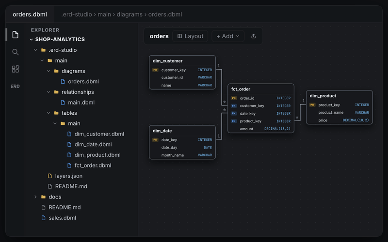

<h1 align="center">ERD Studio</h1>

<p align="center">
  <strong>Design your data model in Git. Let your AI build from it.</strong><br />
  Logical data modelling in VS Code, stored as DBML in your repo.
</p>

<p align="center">
  <a href="https://marketplace.visualstudio.com/items?itemName=liamwynne.erd-studio"></a>
</p>

<p align="center">
  <a href="https://marketplace.visualstudio.com/items?itemName=liamwynne.erd-studio"></a>
  <a href="https://marketplace.visualstudio.com/items?itemName=liamwynne.erd-studio"></a>
  <a href="https://open-vsx.org/extension/liamwynne/erd-studio"></a>
  <br />
  <sub>Free to use, source available under the <a href="https://github.com/liam-machine/erd-studio/blob/main/LICENSE">PolyForm Shield License</a>.</sub>
</p>

<p align="center">
  
</p>

## What it is

ERD Studio is a canvas for logical data modelling in VS Code. You draw tables, keys and relationships; ERD Studio saves them as [DBML](https://dbml.dbdiagram.io/docs), the open-source schema language behind dbdiagram.io, in an `.erd-studio/` folder in your repo. DBML is an open format, so there is no lock-in: DBML parsers (9.1 and later) read your files as a multi-file project, and **Export Diagram…** writes a single file for dbdiagram.io, or Mermaid, any time ([DBML import and export](docs/leaving-erd-studio.md)).

- **In your repo.** The design is reviewed in the same pull request as the code that builds it. No account, server or database.
- **Logical first.** Grain, primary, foreign and natural keys, SCD types, table roles and design rationale, in any folder.
- **Made for your AI.** Claude Code, GitHub Copilot, Codex, Gemini CLI and Cursor read and write the same files, and you review their changes on the canvas.

## The ways to start

[Install ERD Studio](https://marketplace.visualstudio.com/items?itemName=liamwynne.erd-studio) (VS Code 1.85+, or [Open VSX](https://open-vsx.org/extension/liamwynne/erd-studio) for VSCodium, Cursor and Windsurf), open any folder and click **ERD Studio** in the Activity Bar. ERD Studio takes a quick look at the folder, on your machine only, and puts the likeliest start first:

- **New Diagram…** gives you an empty canvas: name it, then use **+ Add → New Table** and **+ Add → New Relationship**. In a new folder with nothing to import, it leads, and **Open an Example…** (a finished coffee-shop model) comes second.

When the folder holds a model to bring in, that import leads instead (the first that applies):

- **Import your Power BI semantic model**, for a Power BI or Fabric semantic model. Tables, columns and relationships come across; measures stay in Power BI.
- **Import your SQL scripts**, for `CREATE TABLE` scripts (PostgreSQL, MySQL, SQL Server, Snowflake, Databricks, Oracle, BigQuery, Redshift or SQLite). Keys, foreign keys and comments come across.
- **Import your DBML file**, for a `.dbml` file from dbdiagram.io or any DBML tool.

Every import opens as a draft: nothing is written until you press **Keep as Diagram**.

**More ways to start…** lists the rest, including **Import…** and **Bring In Your Data Model…**: the export steps for Databricks, Snowflake, Fabric, SQL Server and more ([the guide](docs/import-existing-models.md)).

<table align="center"><tr>
<td width="300"><a href="https://cdn.jsdelivr.net/gh/liam-machine/erd-studio@main/docs/assets/getting-started.mp4"></a></td>
<td><strong>Watch the Tour (2:18).</strong> A recording of ERD Studio in VS Code: import the data model you already have, see its DBML files next to your code, edit it by hand or with your AI assistant, review its DBML and SQL in one pull request, compare the design with what your code builds, then see it on a Confluence page with ERD Studio for Confluence. It is also in the sidebar's <strong>Help &amp; Feedback</strong>.</td>
</tr></table>

## What's in your repo

Commit the `.erd-studio/` folder: that's your data model.

```text
.erd-studio/
├── README.md                     ← what the folders are
├── layers.json                   ← your layers, in order
└── gold/                         ← a layer (silver, gold, …)
    ├── tables/
    │   └── gold/                 ← a schema
    │       ├── dim_customer.dbml ← one file per table, shared by every diagram
    │       └── fct_order.dbml
    ├── relationships/
    │   └── gold.dbml             ← one Ref line per relationship
    └── diagrams/
        └── orders.dbml           ← the tables a diagram shows, and where they sit
```

```dbml
// .erd-studio/gold/tables/gold/fct_order.dbml
Table gold.fct_order [
  role: 'transaction-fact',
  grain: 'One row per order'
] {
  Note: 'Customer orders from the shop and the app.'

  order_id    BIGINT          [pk]
  customer_id BIGINT          [foreign_key: 'true']
  order_total "DECIMAL(12,2)" [additive_type: 'additive']
}
```

Edit on the canvas or in the files, by hand or with AI, and the other follows. ERD Studio's edits are byte-preserving: your comments and hand edits stay. The diagram file keeps the positions ([file format reference](docs/semantic-domain-json-reference.md)). Layers, schema folders, diagrams and relationships files fit how your team works: [modelling patterns](docs/modelling-patterns.md) maps eight warehouse layouts, from medallion and Kimball to Data Vault and data mesh, each with an example project.

Have a YAML/JSON project from before 2.0? It keeps working. [Common questions](docs/faq.md) covers converting it to DBML.

## Work with your AI assistant

In the ERD Studio sidebar, under **Help & Feedback**, click **Set Up My AI Helper**. It finds the assistants on your computer and teaches them ERD Studio's files. Then ask:

> Propose a star schema for orders in ERD Studio, with grain, keys and design rationale. Let me review the diagram before we write any SQL.

Its changes are file edits you review like any other. The helper also adds a guided setup (`/erd-studio-setup`) that designs a first diagram with you. See [AI assistants](docs/ai-assistants.md).

## Using dbt?

dbt is optional. Open the folder that holds your `dbt_project.yml` and the start screen leads with **Import from dbt**, which turns your dbt models into a first diagram to refine by hand or with your AI assistant. The canvas gets two tabs, **Logical** (your design) · **Physical** (read from dbt), and **Compare with dbt** highlights missing columns, type differences and relationship mismatches. No dbt project to hand? Run **ERD Studio: Try the Sample Project**. [Using ERD Studio with dbt](docs/dbt.md) covers the rest. Another stack? [Propose an integration](https://github.com/liam-machine/erd-studio/issues).

## Learn more

- [Common questions](docs/faq.md): upgrading to 2.0 and everyday tasks
- [Bring in the data model you already have](docs/import-existing-models.md) · [DBML import and export](docs/leaving-erd-studio.md)
- [Modelling patterns](docs/modelling-patterns.md), with eight [example projects](docs/examples/)
- [AI assistants](docs/ai-assistants.md) · [Using ERD Studio with dbt](docs/dbt.md) · [Choosing the project folder](docs/project-folder.md)
- [File format reference](docs/semantic-domain-json-reference.md) and [glossary](docs/glossary.md)
- Bug or idea? Run **ERD Studio: Send Feedback**, or [open an issue](https://github.com/liam-machine/erd-studio/issues).
