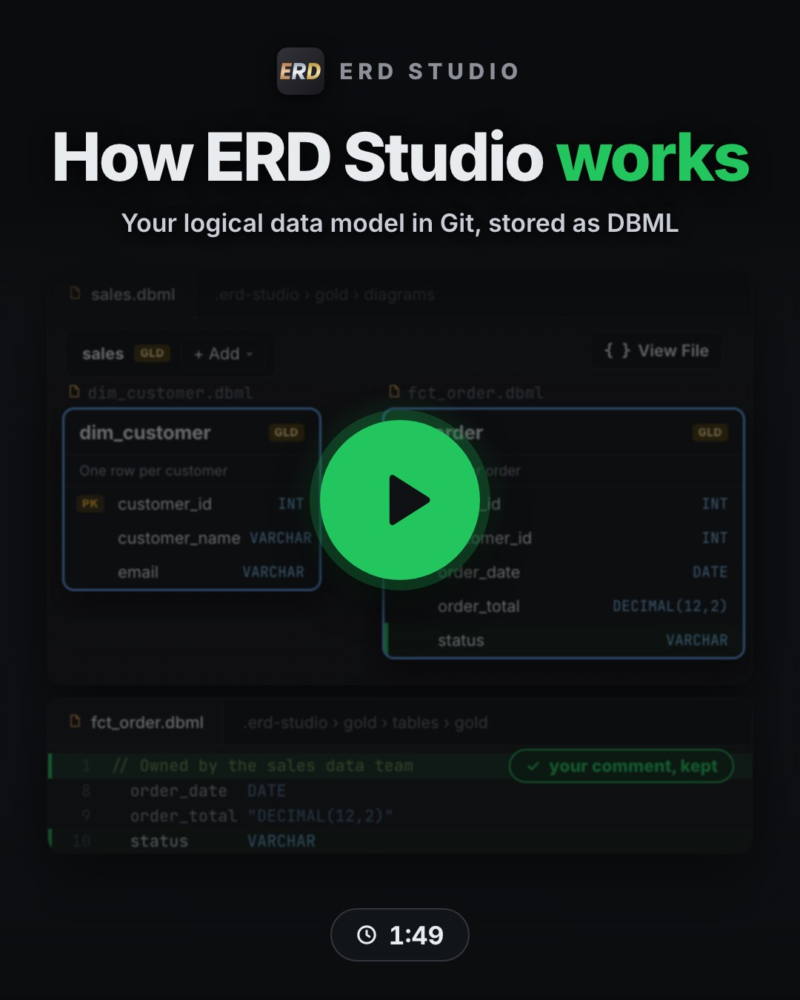

# Using ERD Studio with dbt

ERD Studio is a logical modelling tool first: your design lives in `.erd-studio/` whether or not you use dbt. When the folder you open has a `dbt_project.yml` (or a dbt project below it, or sits inside one, such as its `models/` folder), ERD Studio also reads the dbt project and adds three things:

- **Draw from dbt**, which turns your existing dbt models into a first diagram;
- a read-only **Physical** stage, drawn in green, showing what your dbt project has. The canvas then has two tabs, **Logical** (your design) · **Physical** (read from dbt);
- the **Compare with dbt** overlay, which shows where your design and dbt disagree.

In a folder without dbt the canvas shows only your logical design: there is no Physical tab, no **Compare with dbt** and nothing to install or run. Started your design in a folder without dbt? Move its `.erd-studio` folder into the dbt project, then open that folder to compare your design with what dbt has.

<table align="center"><tr>
<td width="300"></td>
<td><strong>The technical tour (1:49).</strong> Why the logical data model belongs in Git, the layer-first DBML files behind the canvas, a design change as a one-line diff, your AI assistant writing the same files, the ways to start (<strong>Draw from dbt</strong>, then the <strong>Import…</strong> picker's DBML file, SQL DDL scripts and Power BI or Fabric semantic model) and export, the read-only Physical tab and Compare with dbt, and, last, ERD Studio for Confluence, on the Atlassian Marketplace, which reads the diagrams from your GitHub repo so people without VS Code can view them.</td>
</tr></table>

![Your data model lives in the repo, as DBML, and the canvas is a view over it. Left: the VS Code Explorer for a dbt project. Its .erd-studio folder, marked design, holds the logical model as DBML files in a silver layer folder: the orders diagram (diagrams/orders.dbml), the relationships (relationships/silver.dbml), one file per table (tables/silver/dim_customer.dbml and fct_order.dbml) and layers.json. Below it, the models and target folders, marked code and warehouse, hold the dbt SQL, schema.yml, catalog.json and manifest.json, and fct_order.sql is modified. The DBML files render and save as the ERD Studio Logical canvas, in blue: dim_customer joined one to many to fct_order, which has order_total, with the Logical · your design tab and a Compare with dbt button. The dbt project derives the read-only Physical canvas, in green, never written to disk, with the Physical · read from dbt tab and a Stop comparing button. The comparison finds two differences: order_amt is highlighted as only in the warehouse and order_total struck through as logical only, because the column was renamed in the SQL but not in the design. The fix is a one-line change to silver/tables/silver/fct_order.dbml in the same pull request.](https://raw.githubusercontent.com/liam-machine/erd-studio/main/media/readme-workflow.png)

A table drawn from a dbt model with a custom schema (`+schema` or `config(schema=…)`) goes in a schema folder of that name, the same on every machine; otherwise in a folder named after its layer.

## Your first diagram from dbt, no AI needed

1. Open your dbt project in VS Code. On a first install the **Get started with ERD Studio** walkthrough opens and takes you through the next steps.
2. Run **Draw from dbt**, from the walkthrough or the Command Palette (**ERD Studio: Draw from dbt…**). ERD Studio copies your dbt models' columns and relationship tests into a logical draft and opens it, laid out automatically.
3. Edit the draft on the canvas, and switch between **Logical** and **Physical** to compare your design with what dbt has.

The draft is a starting point for your design: it is saved as ordinary ERD Studio files you can change, and the Physical stage is still read from dbt every time, never saved. An empty diagram offers an **Add Tables from dbt** button that does the same for one diagram, and the **ERD** count in the status bar (for example **ERD 3**) takes you back to your diagrams at any time. Rather start blank? **New Diagram…** (in the sidebar's Diagrams view, or **ERD Studio: New Diagram…** in the Command Palette) and **Import DBML…** work in a dbt project too.

**Prefer to watch first?** The [one-minute tour](https://cdn.jsdelivr.net/gh/liam-machine/erd-studio@main/docs/assets/getting-started.mp4) (0:58) shows a diagram and its DBML files, and ends with the Physical tab and **Compare with dbt** in a dbt project. The **ERD Studio Tour** tab has the same video and a short checklist. Open it any time from **Watch the One-Minute Tour** in the sidebar's **Help & Feedback**, or run **ERD Studio: Watch the One-Minute Tour**.

## No dbt project yet? Try the sample

The [ERD Studio sample project](https://github.com/liam-machine/erd-studio-sample) is a small Kimball-style dbt project with fake coffee-shop data (DuckDB, no account needed). It ships its dbt artifacts, so both the Logical and Physical stages work without installing dbt. Run **ERD Studio: Try the Sample Project** (also on the ERD Studio Tour tab) and VS Code clones it to a folder you choose and offers to open it, or use **Code → Download ZIP** on GitHub and open the unzipped folder.

## What the Physical stage reads

The Physical stage has no file of its own. It reads three files, and only the first is required:

- your **schema YAMLs**, always on disk, so the stage works before you have ever run dbt;
- **`manifest.json`**, written by `dbt parse`, `dbt compile`, `dbt run` or `dbt build` (ERD Studio's **Run dbt parse** button runs `dbt parse` for you);
- **`catalog.json`**, written by `dbt docs generate`: the only one of the three that has seen your warehouse.

Each table shows where its shape came from, so a `varchar` on the canvas is never a guess: types are read from the warehouse when the catalog is there, otherwise from the `data_type:` you wrote, otherwise left blank rather than invented. A greyed-out table means it is genuinely not in your dbt project, not that you have not run dbt lately. The edges are the tests you already run (`relationships` for the links, `unique` for the cardinality), so the canvas shows what dbt enforces rather than a second copy that can drift. Nothing is ever written to disk.

## Run dbt parse

A fresh clone has no `manifest.json`, so the Physical stage cannot show your dbt models' columns and tests yet. **Run dbt parse** writes it. You find the button on the Logical stage's "no dbt manifest" strip, in the Physical stage's notice, and in the "no dbt manifest" notifications.

- **Which dbt it uses.** The dbt in your project's own virtual environment (`.venv`, `venv` or `env`) if it has one, or in one in a folder above it, up to the folder you opened in VS Code (a repository that keeps one `.venv` at its root with the dbt project in a subfolder), otherwise the dbt you would run in a terminal. A dbt inside the project that your shell would not run is used only after you agree, because a cloned project can ship any program there. The dbt Cloud CLI cannot run `dbt parse` on your machine: ERD Studio says so, and uses dbt Core instead when it finds one in the project's virtual environment or an environment activated before VS Code started (`VIRTUAL_ENV`, conda, pyenv, `~/.local/bin`). To be sure it is found, install dbt Core with your adapter in the project's `.venv`.
- **Where it runs.** In a **dbt parse** terminal you can watch, and stop with Ctrl+C or by closing it. dbt runs as its own program, with the environment VS Code started with. ERD Studio doesn't activate the project's virtual environment: it runs the environment's own dbt (`bin/dbt`, or `Scripts\dbt.exe` on Windows) directly, so it works in PowerShell too, and nothing the activate script sets is seen. Anything you set in `terminal.integrated.env.*`, or export or activate in a terminal after VS Code started, is not seen: set it before VS Code starts (on macOS and Linux your shell's startup files count) and restart VS Code.
- **When it fails, it says why.** ERD Studio reads dbt's exit code and output on your machine and names the cause in one line: no dbt profile or one dbt can't read, a missing target or environment variable, an adapter that isn't installed, packages that need `dbt deps`, a problem in the project's files, or a dbt version the project does not accept. The notification offers the next step: **Parse without your credentials**, **Run dbt deps** (then dbt parse runs again), **How to install an adapter**, **How to set up a profile** or **Show output**.
- **When it works,** the diagram refreshes, and **Open Physical view** switches it to the Physical stage in one click.

**Run dbt compile** (the Compare panel's button when the manifest is out of date) runs the same way, and also asks before it uses a dbt inside the project.

### Parse without your credentials

`dbt parse` never connects to your warehouse, but it still reads your dbt profile, so on a machine with no `profiles.yml` it stops. **Parse without your credentials** runs it with placeholder connection details instead:

- the placeholder profile is kept in ERD Studio's own storage, never in your project, and holds no secrets: nothing in it connects anywhere;
- ERD Studio never reads your `profiles.yml` (it only checks whether one exists), and with Parse without your credentials dbt doesn't read it either;
- it needs dbt Core installed with one of these adapters: DuckDB, Postgres, Redshift, Snowflake, Databricks, BigQuery, Microsoft Fabric, SQL Server, Trino or Spark (Spark needs `dbt-spark[PyHive]`). When more than one is installed and the project does not say which it uses, ERD Studio asks;
- schema names are left out of the Physical stage, because they would come from the placeholder details. A `catalog.json` from `dbt docs generate` still supplies them;
- models that depend on `target.name`, `target.schema` or a custom `generate_schema_name` may come out differently from your real target;
- the next `dbt parse` with your own profile replaces the manifest (it parses the whole project again, because the profile changed). Before it replaces a manifest written with a real profile (yours, or one committed to the repo or copied from CI), ERD Studio asks.

## Compare and sync

Click **Compare with dbt** on the toolbar. Missing columns, type differences and relationship mismatches appear on the canvas. From the comparison you can generate a sync plan for your AI assistant to apply only the changes you choose. The [AI assistants](ai-assistants.md) page has the guided setup that builds and checks the design against dbt for you.

## Run a whole diagram together

ERD Studio keeps a dbt selector for each diagram in `selectors.yml`, so you can build every dbt model in a diagram with one command, for example `dbt build --selector domain_silver_customer_360`. Run **ERD Studio: Regenerate dbt selectors.yml** to refresh them. ERD Studio only touches the `domain_*` selectors it manages; everything else in the file is left alone.

## More than one dbt project

See [Choosing the project folder](project-folder.md).

## Other stacks

dbt is the only physical source ERD Studio reads today. If you model somewhere else, [contribute an integration or propose one](https://github.com/liam-machine/erd-studio/issues). Your logical table files stay exactly as they are as support grows, and [DBML export](leaving-erd-studio.md) works with any stack.
